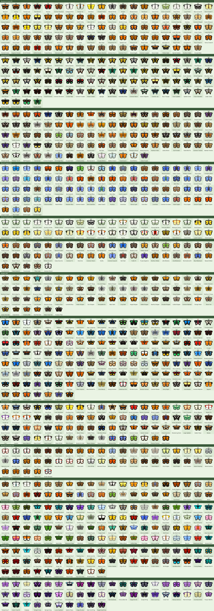
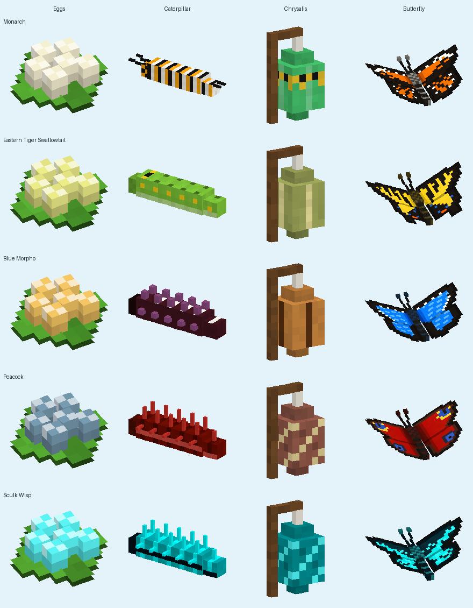
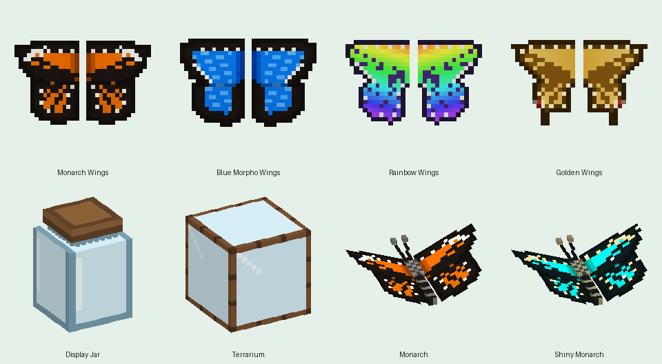

# Butterflies Galore

A Minecraft Bedrock Edition add-on that fills the world with **1,000 unique butterflies**: 897 in the Overworld, 52 in the Nether and 51 in the End. Each one has its own vibrant, hand-designed wing pattern, wing shape, size, flight rhythm and home biome. Every species also has a complete life cycle, from egg to caterpillar to chrysalis to butterfly, and a **Butterfly Handbook** lets you record them all.



## Features

- **1,000 butterfly species in 14 handbook chapters.** Hundreds of real-world species from every continent, like the Monarch, Blue Morpho, Peacock, Zebra Longwing, Apollo, Goliath Birdwing and Queen Alexandra's Birdwing, plus Minecraft-inspired species such as the Cherry Blossom Wing, Sculk Wisp, Pale Garden Ghost, Breeze Wing and Mooshroom Wing.
  - **The Nether (50):** fire-proof butterflies of the crimson and warped forests, soul sand valleys, basalt deltas and Nether wastes, like the Blaze Monarch, Soulfire Wisp and Netherite Emperor.
  - **The End (50):** void-drifting butterflies such as the Chorus Flutter, Shulker Glimmer, Elytra Glider and the legendary Ender Dragon Wing.
- **Full life cycle for every species.**
  - **Eggs:** feed a butterfly a Bottle of Nectar and it lays a cluster of eggs on a leaf.
  - **Caterpillars:** they hatch, crawl and munch. Left alone they take about 40 minutes to grow up. **Seeds** (wheat, melon, pumpkin, beetroot, torchflower, pitcher pods) are their favourite food and speed growth up a lot; leaves, grass and flowers help a little. Nether caterpillars also eat fungus and Nether Wart, End caterpillars eat Chorus Fruit. Each species has its own caterpillar: banded Monarchs, green swallowtails with eyespots, spiky brush-foots, fleshy birdwings and more.
  - **Chrysalis:** a fully grown caterpillar hangs up as a chrysalis that sways and twitches before a new butterfly emerges.
  - Wild caterpillars also appear in each species' home biome.
- **Butterfly Handbook.** Every player gets one on first join. Walk up to any egg, caterpillar, chrysalis or butterfly to record it. Browse 14 chapters of entries with habitat, rarity, wingspan, caterpillar food and a fun fact, and complete all four life stages of each species.
- **Shiny butterflies.** About 1 in 256 butterflies is a rare, sparkling colour form. Butterflies you raise yourself are shiny 1 in 64 times, and a **Shiny Charm** triples your luck. Shiny butterflies stay shiny in a jar and get their own star in the handbook.
- **Wearable wings.** Discover half the butterflies in a chapter to earn its wings, such as Monarch Wings or Blue Morpho Wings (14 pairs). Rainbow Wings unlock at 500 discoveries and Golden Wings at 1,000. Wear them in the chest slot to glide, and jump in mid-air to flap.
- **Milestones and ranks.** Rewards at 10, 25, 50, 100, 250, 500, 750 and 1,000 discoveries, and ranks from Beginner to Butterfly Master.
- **Display Jars and Terrariums.** Show off a living butterfly in a glowing Display Jar or a mossy Terrarium. Use an empty hand to take it back out.
- **Field Notes.** Read them to learn where an undiscovered butterfly lives.
- **Natural spawning by biome.** Meadows, forests, jungles, deserts, badlands, swamps, beaches, snowy biomes, mountains, the pale garden, lush caves, the deep dark, every Nether biome and the End all have their own species, from common to legendary.
- **Lifelike flight.** Butterflies flutter, glide and bob through the air. They visit flowers, flee when hurt and never take fall damage.
- **Catch & release.** Use a **Butterfly Jar** on a butterfly to catch it. Every species has its own jar. Use a filled jar on a block to release the butterfly.
- **New flowers.** Butterfly Bush, Milkweed and Coneflower grow naturally, attract butterflies, feed caterpillars and craft into dye.





See the full [Butterfly Field Guide](docs/species.md) for every species, where it lives and how rare it is.

## Recipes

| Item | Ingredients |
|---|---|
| Butterfly Jar ×3 | 5 Glass + 1 Planks (shaped: planks on top, glass cup below) |
| Butterfly Handbook | Book + Butterfly Jar |
| Display Jar | Butterfly Jar + Glowstone Dust |
| Butterfly Terrarium | 5 Glass + Butterfly Bush (middle) + 2 Planks and Moss Block (bottom row: planks, moss, planks) |
| Field Notes | Paper + Ink Sac + Bottle of Nectar |
| Shiny Charm | 3 Gold Ingots + Diamond + Bottle of Nectar (gold above and on both sides of the diamond, nectar below) |
| Bottle of Nectar | Glass Bottle + Sugar + Dandelion, Butterfly Bush or Milkweed |
| Butterfly Bush | Oak Sapling + 2 Purple Dye |
| Milkweed | Wheat Seeds + Pink Dye + White Dye |
| Coneflower | Wheat Seeds + Magenta Dye + Brown Dye |
| Purple / Pink / Magenta Dye ×2 | Butterfly Bush / Milkweed / Coneflower |

## Installation

1. Download `dist/ButterfliesGalore.mcaddon`.
2. Open it. Minecraft imports both the behavior pack and the resource pack.
3. In your world settings, activate **Butterflies Galore Behavior Pack**. The resource pack is added automatically.

Requires Minecraft Bedrock **1.21.90** or newer.

## Project layout

```
ButterfliesGalore_BP/   behavior pack (mobs, spawn rules, items, blocks, recipes, world features, handbook script)
ButterfliesGalore_RP/   resource pack (models, animations, textures, language)
tools/generate.py       builds both packs, the preview images and the .mcaddon
tools/species_more.py   400 more species, one line each
tools/species_world.py  500 more Overworld species, one line each
tools/handbook.js       source of the Butterfly Handbook script
docs/                   preview images and field guide
dist/                   ready-to-install .mcaddon
```

All packs, textures and docs are generated from the species tables in `tools/generate.py`, `tools/species_more.py` and `tools/species_world.py`. To add or change a butterfly, edit its entry and run:

```
pip install pillow
python3 tools/generate.py
```
